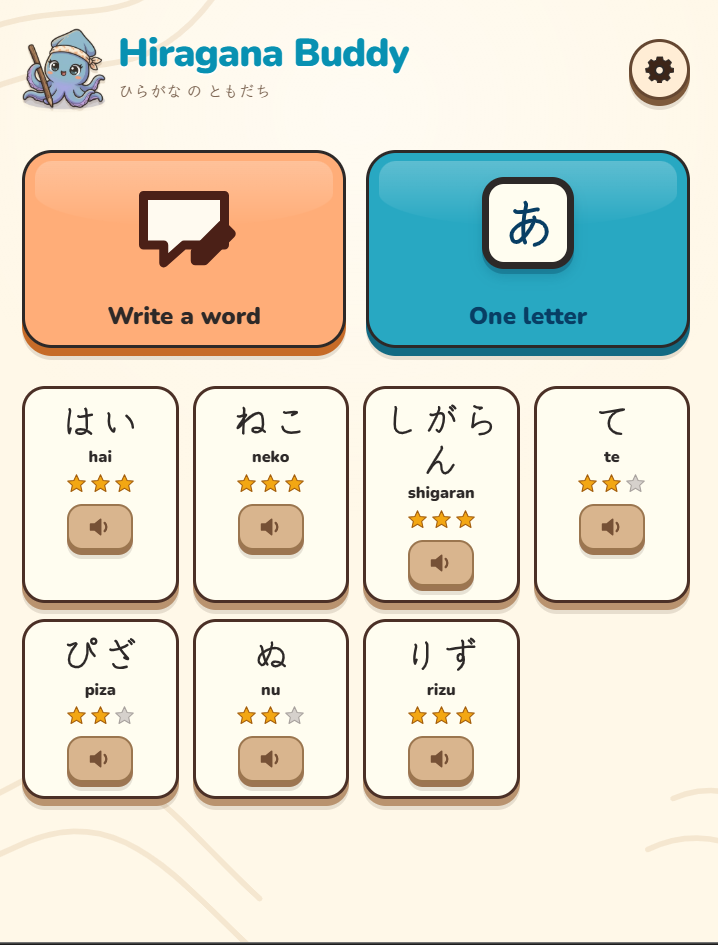
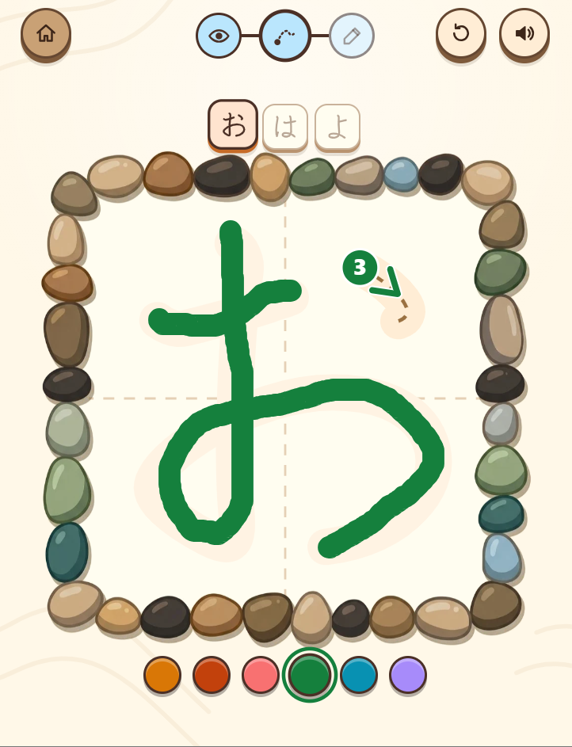
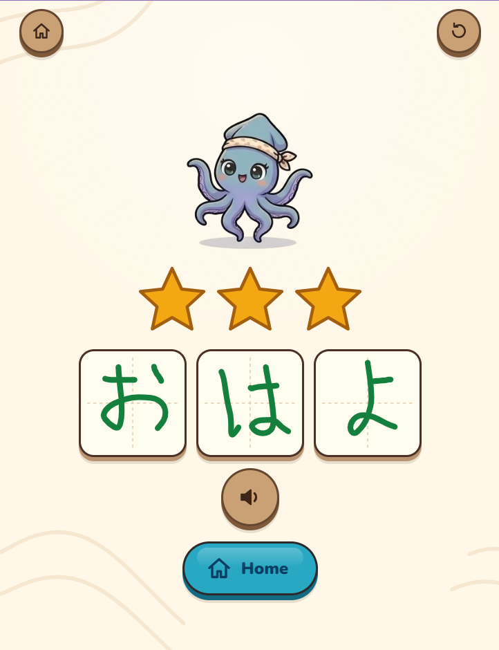
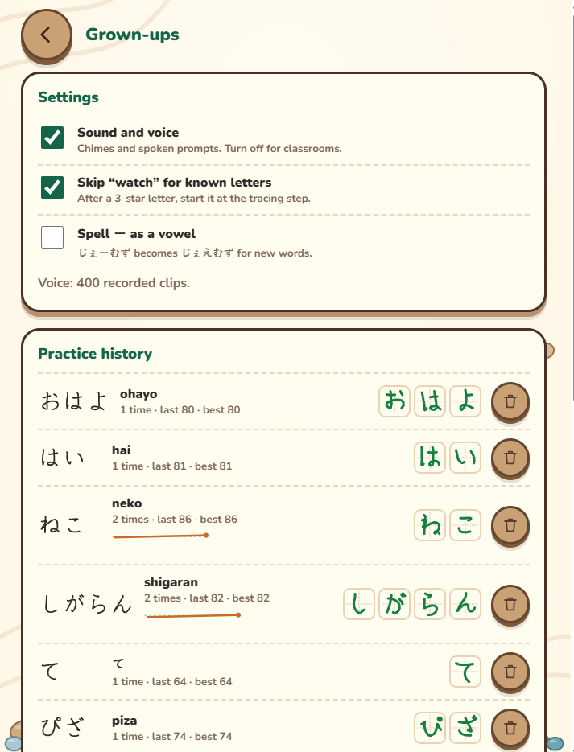
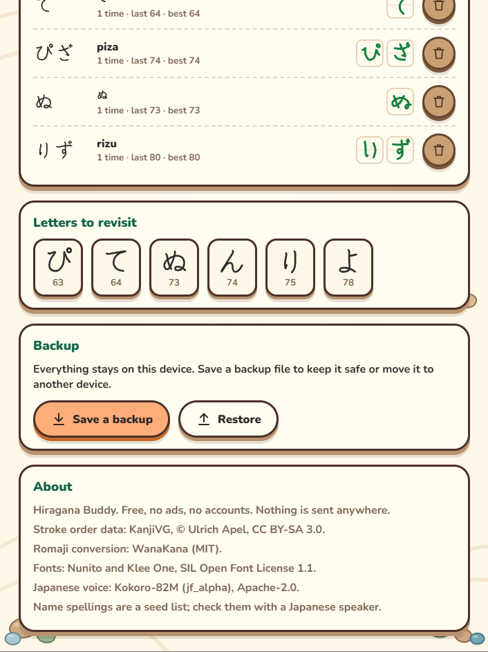

# Hiragana Buddy

A free, offline-friendly web app that teaches young children (ages 5–6, in
English/Japanese immersion kindergarten) to write their name or any word in
hiragana, one stroke at a time: **follow me**, then **trace**, then **write it
yourself**. Correct stroke order is enforced gently: never a red X, always at
least one star. Everything stays on the device: no accounts, no tracking.

<p align="center">
  
  &nbsp;
  
</p>

| | | |
| :---: | :---: | :---: |
|  |  |  |
| **My word**: stars, the child's own letters, a celebration dance | **Grown-ups**: settings (behind a press-and-hold gear) | **Grown-ups**: history, letters to revisit, backup |

- **Words or single letters.** Type a name or word in English (Emma, dinosaur) or
  how it sounds (ne-ko); on supported devices, say it into the private,
  on-device microphone. Check the kana tiles, then hand it over.
- **Three steps per letter.** Watch-and-trace with an animated demo, trace a
  ghost, then write from memory inside a ring of stones. Missed strokes replay;
  after three misses the stroke goes back to "follow me".
- **Friendly voice.** Recorded Japanese clips for every kana and the built-in
  name list; English prompts use the device's natural voice.
- **Works offline** as an installable web app; history and a JSON backup live on
  the device.

Run it locally: `npm install`, then `npm run serve` and open
http://localhost:4173. See [Development](#development) below.

---

## Resource pack

Everything a Claude Code agent needs to start building the app, beyond the
design doc. Copy everything in this folder into the root of your repo and point Claude Code at
`CLAUDE.md`.

```
docs/DESIGN.md                full design doc (Markdown export of the living doc)
CLAUDE.md                     agent brief: rules, stack, milestones, acceptance checks
data/kana-strokes.json        KanjiVG stroke data, 87 glyphs (CC BY-SA 3.0)
data/kana-table.json          chart layout, romaji, speech text
data/en-names-words.json      176 names + 44 words -> hiragana (seed list, please review)
data/ATTRIBUTION.md           licences and the About-screen credit line
reference/stroke-matcher.js   tested reference matcher + scoring + hot/cold
reference/kana-preview.png    contact sheet of every glyph's stroke order
tests/matcher.test.mjs        synthetic child-trace tests: node --test tests/matcher.test.mjs
scripts/                      rebuild the data (Python 3, no dependencies; preview needs Pillow)
```

Rebuild stroke data:

```
git clone --depth 1 https://github.com/KanjiVG/kanjivg.git
python3 scripts/build_kana_strokes.py kanjivg/kanji data/kana-strokes.json
python3 scripts/render_preview.py data/kana-strokes.json reference/kana-preview.png
```

Edit names: change `NAMES` / `WORDS` in `scripts/build_name_dictionary.py`, then
`python3 scripts/build_name_dictionary.py data/en-names-words.json`.

## Development

```
npm install
npm run dev          # http://localhost:5173
npm test             # matcher suites (reference + TS port) and Vitest unit tests
npx playwright install chromium   # once
npm run test:e2e     # mouse/touch flows on phone and tablet viewports
npm run build        # static site in dist/
npm run serve        # build, then preview the real site at http://localhost:4173
npm run serve:lan    # same, reachable from a phone/tablet on your Wi-Fi
npm run design-export   # screenshots + editable SVGs of every screen for Figma
npm run icons        # regenerate public/ icons from the あ stroke data
```

Pushing to `main` runs `.github/workflows/deploy.yml`, which tests, builds and
publishes to GitHub Pages. In the repo settings, set Pages → Source to
"GitHub Actions" once.
